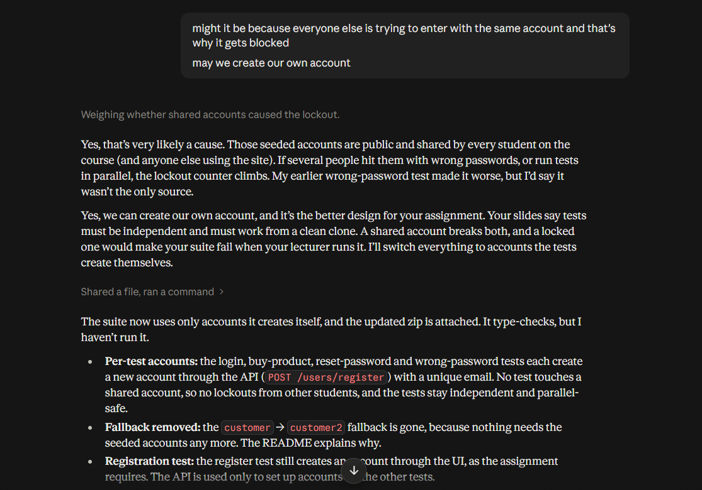

1."I'm doing a university assignment (Software Testing and Debugging) and need a
Playwright + TypeScript test suite for https://practicesoftwaretesting.com.

Write five tests, one spec file each: register, login, buy a product, compare two
products, reset password. Use page objects (no locators in specs), a fixtures
file, and a data factory for unique emails. Use data-test attributes via
testIdAttribute. No waitForTimeout, no CSS-class or XPath locators, and every
test needs an assertion that could actually fail. Tests must be independent and
pass in parallel.

If you can't open the site, tell me which locators you couldn't verify.
Then check your own work against these rules.

Here is the project: <Here i sent an html file of the project>"

2. <I was getting an error here> might it be because everyone else is trying to enter with the same account and that's why it gets blocked

may we create our own account

Model: claude sonnet 5.5 medium 